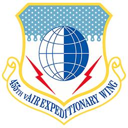
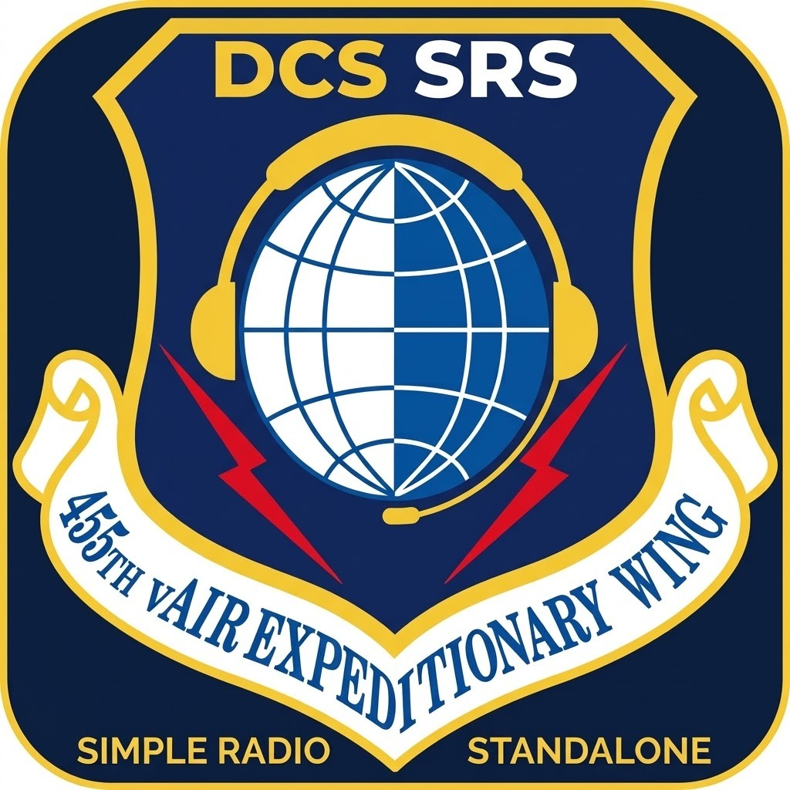

# 455th vAEW SRS

  
  &nbsp;&nbsp;&nbsp;
  

A 455th-maintained SRS client for DCS World. Built on [DCS SimpleRadio Standalone](https://github.com/ciribob/DCS-SimpleRadioStandalone) and the [OpenFreqAudio](https://github.com/UOAF/OpenFreqAudio) receiver DSP, then extended for AEW / multiplayer use — not a straight drop-in of either project.

**Download:** https://github.com/hbjonsson/DCS-SimpleRadioStandalone/releases/latest

Prefer the MSI for in-place upgrades into `Program Files\455th-SRS\Client`. A ZIP portable build is also published on each release.

## What’s different in this fork

Based on upstream SRS **2.4.1.0**, with fork iterations published as `2.4.1.0+N`. Full cockpit / FC3 integration from SRS is retained.

### Radio audio: a receiver simulation, not an EQ

Every radio is simulated as a real receiver, tuned to the AN/ARC-210 specification (MIL-R-29583) and checked by spec tests:

- **AM / HAVEQUICK**: carriers, envelope detector, AGC and carrier squelch. Two stations at once give a heterodyne beat note.
- **FM / SINCGARS**: FM discriminator with quieting, threshold clicks, capture by the stronger station and a noise squelch with its tail.
- **Encrypted, MIDS, SATCOM**: 16 kbit/s CVSD digital voice that garbles near the edge of range.
- **Intercom**: wired, wider band, no RF noise.
- **Transmitter model**: each talker is levelled and soft-clipped to about 85% modulation, with cockpit noise kept about 17 dB under the voice.

**Deep dive:** [How the 455th SRS radio simulation works](docs/radio-simulation.md) covers the design, the comparison with stock SRS and OpenFreq, the known gaps and the roadmap.

### Client reliability & recording

- **Auto-reconnect** after unexpected server drops (backoff ~2s → 30s, in-window status, no focus-stealing dialogs). Intentional disconnect, app close, idle timeout, and version mismatch do not reconnect.
- **Recording ready for debrief** — transmission recording on by default for new installs; configurable recordings folder; UTC filenames for Tacview / media sync; a failed recorder start no longer kills radio audio.

### Packaging & product

- **Side-by-side install** — separate 455th product, icon, and settings under `%LOCALAPPDATA%\455th-SRS`. MSI upgrades in place (including same upstream version via `+N` builds). Does not modify official SRS or its DCS scripts.
- **English-only UI** for this fork build.

See [packaging/455th/CHANGELOG.md](packaging/455th/CHANGELOG.md) for per-release detail.

## Install notes

- Official SRS and 455th vAEW SRS can be installed together. Do not run both clients against DCS at once (same DCS export ports).
- In DCS **Options → Special → DCS-SRS**, disable **Auto Launch SRS** so official SRS does not start while you use 455th. AutoConnect still works if 455th is already running.
- Keep official SRS installed if you still want its Saved Games scripts; this client does not replace them.

## Credits & licensing

This is a **modified** version of DCS SimpleRadio Standalone. Credit for the original radio client belongs to **ciribob** and the SRS contributors:

- Upstream SRS: https://github.com/ciribob/DCS-SimpleRadioStandalone
- Upstream releases and donation links remain on that repository

OpenFreq AM demodulation / DSP primitives come from **OpenFreqAudio** (Mozilla Public License 2.0). Integration into SRS, modulation-safe routing, volume/tone behaviour, ambience hybridisation, reconnect, recording UX, and packaging are 455th fork work on top of that base:

- OpenFreqAudio: https://github.com/UOAF/OpenFreqAudio

SRS-derived code remains under **GNU GPL v3** (see [LICENSE](LICENSE)). OpenFreqAudio remains under **MPL-2.0**. Corresponding source for this fork:

- https://github.com/hbjonsson/DCS-SimpleRadioStandalone

Installer distribution notices: [packaging/455th/SOURCE.txt](packaging/455th/SOURCE.txt).
