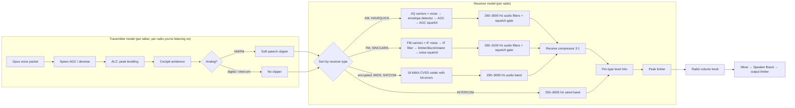

# How the 455th SRS radio simulation works

*Written for release 2.4.1.0+7.*

Most voice programs for flight sims make radio sound with an equalizer: they cut the bass, add hiss and
some distortion, and lower the volume with distance. That sounds like a radio, but nothing in it behaves
like one.

This client simulates the radios instead. Each incoming transmission is put back onto a simulated carrier
and passed through a model of the receiver: a noise floor, an envelope or FM detector, AGC, squelch, the
audio filters and the receive compressor. What the receiver can't do on its own (a talker's microphone
level, their cockpit noise) is handled by a model of the transmitter, which runs on your PC for each
person you hear.

The numbers come from the procurement specification of a real radio, **MIL-R-29583(AS), the AN/ARC-210
spec**, and the code is tested against them. When two stations transmit at once, when a signal is weak,
or when someone unkeys, you hear the right thing because the model produces it, not because a rule says so.

This page covers how it works, how it differs from stock SRS and from OpenFreq, which parts are simplified
or missing, and what we may do next. If you maintain SRS, OpenFreq or a similar project, you are welcome to
take anything here; see [Taking this upstream](#taking-this-upstream).

---

## Contents

1. [The design rules](#the-design-rules)
2. [The full signal path](#the-full-signal-path)
3. [Transmitter: the sender's radio](#transmitter-the-senders-radio)
4. [AM receiver](#am-receiver)
5. [FM receiver](#fm-receiver)
6. [Digital voice: KY-58, MIDS, SATCOM](#digital-voice-ky-58-mids-satcom)
7. [Intercom](#intercom)
8. [Shared receive stages](#shared-receive-stages)
9. [Signal strength, fading and frequency error](#signal-strength-fading-and-frequency-error)
10. [How the spec is enforced: tests](#how-the-spec-is-enforced-tests)
11. [Compared with stock SRS and OpenFreq](#compared-with-stock-srs-and-openfreq)
12. [Gaps and simplifications](#gaps-and-simplifications)
13. [Roadmap ideas](#roadmap-ideas)
14. [Taking this upstream](#taking-this-upstream)
15. [Sources](#sources)

---

## The design rules

1. **The network is not touched.** The wire protocol and the servers are stock SRS 2.4.1.0. All of the
   simulation runs on the **receiving** client. You can use this client on any SRS server alongside stock
   SRS clients, and everyone hears their own client's version of the sound.
2. **Model the physics and let the behaviour follow.** We don't write rules like "if two FM signals
   overlap, play the louder one." We build an FM discriminator, and capture happens because that's what
   discriminators do.
3. **Every value comes from a spec, or is labelled as a guess.** Where a number isn't backed by a spec, the
   code comment says so (see intercom).
4. **The spec is tested.** Passband, squelch timing, distortion, quieting and levels are checked in unit
   tests, so a later change can't quietly undo the realism.

---

## The full signal path



Where it lives in the code:

| Stage | File |
|---|---|
| Per-talker decode, transmitter model | `Common/Audio/Providers/ClientAudioProvider.cs`, `TransmitterProcessor.cs` |
| Sorting a radio's traffic, squelch tail after key-up | `Common/Audio/Providers/RadioMixingProvider.cs` |
| Receiver selection, signal strength, fading, compressor, levels | `Common/Audio/Providers/OpenFreqReceiverEffectsPipeline.cs`, `ReceiveCompressor.cs` |
| AM receiver | `libs/OpenFreqAudio/OpenFreqAudio.Dsp/RadioReceiverProcessor.cs` |
| FM receiver | `libs/OpenFreqAudio/OpenFreqAudio.Dsp/FmReceiverProcessor.cs` |
| CVSD digital voice | `libs/OpenFreqAudio/OpenFreqAudio.Dsp/CvsdVoiceCodec.cs` |
| Squelch fade | `libs/OpenFreqAudio/OpenFreqAudio.Dsp/SquelchGate.cs` |
| Procedural cockpit noise | `libs/OpenFreqAudio/OpenFreqAudio.Dsp/ProceduralAmbientProcessor.cs` |
| Output limiter | `Common/Audio/Utility/PeakLimiter.cs` |

Everything runs at 48 kHz in 32-bit float. Each receiving radio has its own receiver instances, so AGC,
filter and squelch state carry over from one audio buffer to the next, as they would in a real set.

---

## Transmitter: the sender's radio

SRS sends the talker's raw microphone audio. A real radio doesn't transmit it that way: the transmitter
**levels and clips** the speech so it fully modulates the carrier. We think this is the biggest single
reason flight sim radio sounds wrong, and it's the first thing we fixed after reading VATSIM's afv-native
(see [Sources](#sources)).

`TransmitterProcessor` runs once for each talker on each radio you're listening on:

1. **Automatic level control** (MIL-R-29583 3.5.1.16.8.2: at least 80% modulation at normal mic input).
   A peak follower with 20 ms attack and 1 s release, gain capped at +20 dB, aiming for a peak of 0.95.
   A steady tone ends up at about 85% AM. The fast attack catches the first syllable; the slow release
   holds the gain steady through a sentence instead of pumping between words. The gain starts at the cap,
   so a quiet talker is heard at full level from their first word.
2. **Cockpit ambience is added after the levelling.** This order matters. If ambience goes in first, the
   ALC raises the engine noise every time the talker pauses, and with a quiet mic the background ends up
   as loud as the voice (which is what +6 did). Added afterwards, it sits about 17 dB under the voice
   whatever the talker's mic level. Supported aircraft (F-16, F-15, A-10, ground units, ground stations)
   get **procedural** profiles from OpenFreq, for example the A-10's ~400 Hz machinery tone with a slow
   2 Hz lope. These do more than add noise. Engine rumble slightly modulates the voice's amplitude. A
   low-passed copy of the voice (cutoff about 0.9–2 kHz depending on the aircraft) is blended in as a
   rough **oxygen-mask muffle**. A soft saturator then adds a little character. Other aircraft use SRS's
   WAV loops, mixed under the voice.
3. **Soft speech clipper**, AM and FM only. Below 0.6 it does nothing; above that a tanh curve flattens the
   peaks and never passes ±1 (100% modulation). This gives loud syllables the radio "grit" while keeping
   distortion within the transmit spec (≤5%, 3.5.1.16.8.2.3). Digital voice and intercom skip it: a KY-58
   digitises the levelled mic audio directly, and an intercom has no RF stage.

The result: a whisperer and a shouter come out at nearly the same level, as on a real net.

---

## AM receiver

*AM and HAVEQUICK traffic. Started from OpenFreq's design, then tuned to the ARC-210 spec here.*

### Carriers at complex baseband

For each output sample, every transmitter you can hear on that frequency is rebuilt as an AM carrier, in
I/Q (complex) form:

```
i = noise_i + Σ_k  A_k · (1 + 0.95 · m_k[n]) · cos(2π · Δf_k · t)
q = noise_q + Σ_k  A_k · (1 + 0.95 · m_k[n]) · sin(2π · Δf_k · t)
envelope = √(i² + q²)
```

- `A_k` is the carrier amplitude relative to the noise floor, `10^(SNR/20)`.
- `m_k` is that talker's voice after the transmitter model.
- `Δf_k` is the carrier's frequency error (see [Frequency error](#frequency-error)).
- The noise depends on the band: below 200 MHz it's VHF crackle (pink noise plus ignition-style pops),
  above it's smooth UHF hiss.

The detector is an **envelope detector**: the magnitude of the summed I/Q vector. That one choice gives you
the following without any special code:

- **Two stations transmitting at once** add as vectors. Because their carriers sit a few hundred Hz apart,
  you hear both voices **and a heterodyne whistle** at the difference frequency. That's how AM actually
  "blocks", and it's why AM is used for ATC: you know someone stepped on you.
- **Weak signals get noisy** in a realistic way. The noise is in the envelope, not added on top of it, so
  near the noise floor the voice and hiss interact the way they do on a real detector.

### AGC

The AGC tracks the envelope with **1 ms attack and 3.3 ms decay**, and the detector output is
`envelope / AGC − 1`, which takes away the carrier and leaves the audio. The output is limited to ±1, as a
real detector saturates. This limit fixed a real bug: when a new carrier arrives, the AGC needs a moment to
catch up, and the raw ratio overshoots by up to the carrier's SNR. Before the fix, that produced a
**+11 dBFS crack at every key-up**.

### Squelch

The AM squelch is carrier-operated: it opens when the AGC level is at least 2.0 (+6 dB over the noise
floor). The receiver keeps detecting while the squelch is closed, and the mute is applied **after** the
audio filters with a 2 ms fade (`SquelchGate`). If you gate the raw detector instead, the carrier's DC
level steps into the filters each time the squelch opens, and you hear a click.

### Audio filters (3.5.1.15.4.5.1)

The spec: 300–3000 Hz within +1/−3 dB, at least 37 dB down at 150 Hz, at least 25 dB down at 8 kHz.

- High-pass: **7th-order Butterworth at 290 Hz**, built as cascaded biquads. A single 7th-order transfer
  function at 290 Hz and 48 kHz is numerically unstable.
- Low-pass: **6th-order Butterworth at 3000 Hz**.

The steep high-pass is what makes it sound like a real radio. A gentle 2nd-order one leaves enough low end
that the voice sounds like a phone call.

---

## FM receiver

*FM and SINCGARS traffic. New in this fork, based on the ARC-210 FM mode.*

Neither stock SRS nor OpenFreqAudio has an FM receiver: SRS runs FM through the same EQ chains as AM and
picks a winner by rule, and OpenFreq's receiver is AM only. `FmReceiverProcessor` is a real narrowband FM
receiver:

1. **Carriers.** Each transmitter is a phase-continuous FM carrier at complex baseband, with full
   modulation at **±8 kHz** deviation. The spec pairs 90% with ±7.2 kHz (3.5.1.15.4.5.4). Each carrier's
   phase is kept between buffers, keyed by the sender, so a carrier never jumps phase at a buffer boundary.
2. **IF noise.** Gaussian noise scaled so that `A²` is exactly the carrier-to-noise ratio in the IF
   bandwidth.
3. **IF filter.** 4th-order low-pass at 10 kHz on I and Q, so 20 kHz wide in total. The spec asks for at
   least 17.5 kHz at the 6 dB points (3.5.1.15.2).
4. **Limiter and discriminator.** The audio is the phase change between consecutive samples
   (`atan2` of `z[n]·conj(z[n−1])`), so the carrier amplitude has no effect on it.

That gives the familiar FM behaviour, with no special code for any of it:

- **Quieting.** A strong signal removes the hiss completely. The tests check ≥33 dB (S+N)/N (3.5.1.15.6).
- **Threshold clicks.** Near the edge, the noise sometimes sweeps the phase all the way round, and you hear
  the crackle of a weak FM signal.
- **Capture effect.** With two stations keyed, the stronger one takes over the limiter and the weaker one
  mostly disappears. When they're close in strength, both break through, as on a real radio. Stock SRS
  does this with a rule ("play the loudest"), and before our +4 fix that rule picked the weakest station.
- **Constant audio level** from the edge of range to full strength (3.5.1.15.16, within 3 dB), because the
  limiter removes amplitude.

### Noise-operated squelch (3.5.1.15.3)

The FM squelch measures the discriminator's noise **above** the voice band (4th-order high-pass at 5 kHz,
RMS over 5 ms):

| | Threshold | Spec |
|---|---|---|
| Opens below | 0.18 (≈ 5 dB SINAD) | opens above 5 dB SINAD |
| Closes above | 0.25 (≈ 3 dB SINAD) | closes below 3 dB SINAD, 2–6 dB hysteresis |
| Release hold | 120 ms | 100–175 ms |
| Attack | < 30 ms (tested) | ≤ 30 ms |

When the carrier drops, the discriminator returns to noise, and the squelch waits 120 ms before closing.
So you hear **the short burst of noise at the end of every FM transmission**, made by the same mechanism as
in the real radio. To let it play, the mixer keeps the receivers running for **200 ms after the last
packet** (`DrainMilliseconds`).

The audio filters are the same as on AM, except the low-pass is at 3100 Hz.

---

## Digital voice: KY-58, MIDS, SATCOM

*Any encrypted traffic, plus MIDS and SATCOM. New in this fork.*

A real KY-58 (VINSON) on a narrowband radio sends **16 kbit/s CVSD**, and Link 16 voice is CVSD too. CVSD
has a distinctive grainy, slightly robotic sound. Stock SRS already passes encrypted audio through a CVSD
effect, but at a fixed quality whatever the range. Our `CvsdVoiceCodec` adds bit errors that depend on
signal strength, and follows the standard CVSD design:

- Bit rate **16 kbit/s**, the 48 kHz voice decimated by 3.
- **1 ms** principal integrator, **5 ms** syllabic filter.
- **3-bit coincidence** step control (three identical bits in a row → step size up), steps 0.006–0.3.
- 3.4 kHz anti-alias and reconstruction filters.

The codec's own artefacts come out naturally: granular noise in quiet parts, and **slope overload** (a
slurred sound) on fast transients.

**Bit errors** go in between the encoder and decoder, based on signal strength. We assume non-coherent FSK
with Eb/N0 3 dB below the RF SNR:

```
BER = ½ · exp(−Eb/N0 / 2)
```

At close range the link is error-free. Near the edge the voice garbles: CVSD decoders lose their step size
and pop, and that's what an encrypted net at the edge of range sounds like, with no hiss at all. MIDS and
SATCOM have their own error correction and are treated as error-free.

The decoded voice then goes through the same 290–3000 Hz audio stage as the analog modes.

---

## Intercom

Intercom has no RF stage: no carrier, no noise, no squelch, no receive compressor. It gets a wider
**250–6000 Hz** band (2nd-order high-pass, 4th-order low-pass), so it sounds clearly better than the radios,
as it does in the jet.

> **This is a guess.** We found no spec for aircraft intercom audio bandwidth, and the code comment says so.
> If you have a real reference, please open an issue.

---

## Shared receive stages

### Receive compressor (3.5.1.15.4.5.8)

The spec says the receive compressor must start acting at 25–35% AM or ±2.0–2.8 kHz FM deviation.
`ReceiveCompressor` uses a 3:1 ratio with 5 ms attack and 150 ms release. The threshold is 0.25 for AM and
0.28 for FM and digital. AM needs a lower threshold because the AGC-normalised AM detector isn't linear:
20% modulation gives 0.17, 30% gives 0.25, 85% gives 0.60. The spec doesn't give a ratio, so 3:1 is our
choice. It's slow enough to stay within the distortion limits on a steady tone (3.5.1.15.4.5.4).

### Same level on every mode (3.5.1.15.4.5.7)

The spec says other modes must be within ±2 dB of normal-mode audio level. Each receiver type has an output
trim (AM 1.84, FM 1.5, digital 1.7, intercom 1.0), measured on speech so that switching from AM to FM to
encrypted doesn't change the loudness. A test enforces it.

Measured on synthesised speech with F-16 ambience: voice at **−12 to −13 dBFS RMS** on every mode, peaks at
−0.2 dBFS, and ambience 16–17 dB under the voice in pauses.

### Limiters, not clipping

After the compressor, a mono peak limiter catches syllable onsets the compressor is too slow for. At the
very end, after Speaker Boost, a channel-linked peak limiter (instant attack, 100 ms release, ceiling 0.98)
replaces upstream's hard clamp. With several radios active and the boost turned up, you get a brief duck,
not crackling.

### Traffic the receivers don't process

- **Failed decrypt** (wrong key): white-noise static at radio volume, as in stock SRS.
- **`NoAudioEffects`** (server global frequencies): played clean.
- **Mixed traffic on one radio** (for example AM and FM, or clear and failed-decrypt): sorted by type, so
  each part gets the right receiver and one odd segment can't change how the rest sounds.

### Also processed

- **Recordings** capture what you heard, after the receivers, including squelch tails.
- **The mic passthrough output** (used by streamers) plays your own voice through the same transmitter and
  receiver models.

---

## Signal strength, fading and frequency error

### Signal strength

SRS already works out two numbers per transmission:

- `ReceivingPower`: distance as a fraction of the Friis maximum range for that frequency (40 dBm
  transmitter, −90 dBm sensitivity). Despite the name, 0 is strong and 1 is the edge.
- `LineOfSightLoss`: from DCS's terrain line-of-sight check.

We combine them, `combined = 1 − (1 − distance)(1 − los)`, and map the result linearly to an
**SNR of 10–45 dB**. That SNR sets the carrier amplitude for AM and FM and the bit error rate for digital.

This is the weakest part of the model; see [Gaps](#gaps-and-simplifications).

### Fading

Ported from OpenFreq's `FastPathAudioSim`. Two kinds of Poisson-timed events, more frequent as the SNR drops:

- **Flutter**: short multipath dropouts. Duration exponential with an 80 ms mean, at least 20 ms, 8 ms
  edges. They mute the voice but leave the carrier, so the squelch stays open.
- **Deep fades**: duration exponential with a 1.2 s mean, at least 400 ms, 50 ms edges. They also lower
  the carrier, so the squelch can drop out and reopen in the middle of a word.

### Frequency error

Each transmitter has a fixed crystal error between −2.5 and +2.5 ppm, derived from a hash of its client
GUID, so a given person always sounds the same. On top of that comes any difference between their frequency
and yours. At 250 MHz, 2.5 ppm is 625 Hz, so two stations transmitting at once on AM give a beat note in the
audible range, and it's different for each pair of people.

---

## How the spec is enforced: tests

`DCS-SR-CommonTests/Audio/` measures the receivers with test signals, as a bench test would:

| Test file | What it checks |
|---|---|
| `ArcRadioSpecTests.cs` | AM passband (300–3000 Hz, 150 Hz and 8 kHz rejection), transmitter modulation ≥80% and distortion ≤5%, quiet and loud talkers at the same level, AM compressor onset, AM receive distortion |
| `ReceiveChainSpecTests.cs` | FM quieting and threshold, FM distortion, FM passband, constant FM output level, FM capture, FM squelch attack ≤30 ms and release 100–175 ms with a noise tail, no AM key-up crack, CVSD clean versus garbled, digital BER versus range, **all modes within 2 dB** |
| `ModulationRoutingAndVolumeTests.cs` | Which modulation goes to which receiver, and that radio volume is applied |
| `PeakLimiterTests.cs`, `PostDspRecordingTests.cs`, `ProceduralAmbientProcessorTests.cs`, … | Limiter, recording and ambience |

Run them from Windows with `dotnet test DCS-SR-CommonTests`.

---

## Compared with stock SRS and OpenFreq

Credit first: **SRS** (ciribob and contributors) is the whole client, network and DCS integration. We only
replaced how the audio sounds. **OpenFreq / OpenFreqAudio** (UOAF) supplied the AM receiver idea, the
noise generator, procedural ambience and the fading model. This fork builds on both.

| | Stock SRS 2.4.1.0 | OpenFreqAudio | 455th SRS |
|---|---|---|---|
| **How the sound is made** | EQ, saturation and compression chains, per radio model (JSON) | AM receiver simulation | Receiver simulation for every mode |
| **AM** | Filtered and saturated voice, distance-based hiss | I/Q envelope, AGC, squelch, band-pass | Same, plus spec-accurate 7th-order filters, detector saturation (no key-up crack), filtered squelch gate, receive compressor |
| **FM / SINCGARS** | Same EQ as AM, capture by rule | – | Full FM receiver: discriminator, quieting, threshold clicks, capture, noise squelch with tail |
| **Two stations at once on AM** | Both voices mixed | Vector sum with beat note | Vector sum with beat note, crystal error per sender |
| **Encrypted / MIDS** | CVSD effect at fixed quality, plus tones | – | 16 kbit/s CVSD with bit errors from signal strength, garbles near the edge |
| **Intercom** | EQ preset | – | Wired band, no RF |
| **Transmitter** | Raw mic | Makeup gain and soft limiter inside the cockpit profiles | Peak-following ALC (spec modulation depth) plus soft clipper, on every analog talker |
| **Cockpit noise** | WAV loops, mixed under the raw mic | Procedural, with mask muffle | OpenFreq's procedural profiles or WAV, added after the ALC (fixed level under the voice) |
| **Distance** | Volume fade and hiss | Terrain propagation model (Delta-Bullington, two-ray) | SRS distance and LOS mapped to SNR (simplified, see gaps) |
| **Level across modes** | Varies by model | AM only | All modes within 2 dB, tested |
| **Clipping at the output** | Hard clamp | – | Peak limiter |
| **NATO / HAVEQUICK tones** | Looping tones | – | Removed (not real receiver audio) |
| **Spec tests** | – | – | Yes |

A note on the stock SRS radio models: they are well made and sound good. But an EQ curve only describes how
a radio sounds with one strong signal. It can't produce a squelch tail, capture, a beat note or a garbled
CVSD frame. Those behaviours are what tell an experienced radio user what's happening on the net.

---

## Gaps and simplifications

Listed honestly, roughly by how much they affect what you hear.

1. **Signal strength is a lookup, not a link budget.** SRS's distance and LOS values are mapped linearly to
   10–45 dB SNR, and the **floor of 10 dB keeps every station above squelch**. On FM, 10 dB CNR is already
   clean (~17 dB SINAD), so the hissy, barely readable range you get on a real radio never happens on FM.
   Digital at 10 dB is about 4% BER, which is garbled, so digital fails earlier than analog. That isn't
   balanced yet.
2. **Deep fades never happen.** Their rate is zero above 10 dB SNR, and the SNR floor is 10 dB. Flutter
   only happens in the bottom ~5 dB of the range.
3. **No terrain propagation of our own.** We use DCS's yes/no-ish LOS value and SRS's range calculation.
   OpenFreq has a much better Delta-Bullington diffraction model that we don't use yet. It needs terrain
   height data, which SRS doesn't have.
4. **The AM squelch has no hysteresis.** The FM squelch has it, the AM one doesn't yet. The AM squelch also
   doesn't have the spec's 100–175 ms release.
5. **One radio model for everyone.** Every radio sounds like an ARC-210. The ARC-186 (A-10C VHF) has a
   flat 300–3200 Hz passband, and the ARC-164 and ARC-222 (F-16C) are different again. SRS knows the
   aircraft type, but we don't have per-radio profiles yet.
6. **The oxygen mask and helmet microphone are rough.** The procedural profiles blend in a simple
   low-passed copy of the voice, tuned by ear, and aircraft on WAV ambience get no mask at all. This is
   probably most of the remaining "fighter pilot" sound. We have no spec data for it.
7. **The crystal error is wider than the spec.** The ARC-210 is specified to ±1 ppm; we use ±2.5 ppm so
   the beat notes are clearly audible. This is a deliberate choice for effect.
8. **Sidetone level hasn't been checked** against the spec (6 ±1 dB below receive level).
9. **The passthrough output has no squelch tail.** Your own FM voice on the streamer output ends without
   the noise burst.
10. **The audio preview is AM only.**
11. **The intercom bandwidth is a guess.**
12. **No HF model.** HF frequencies go through the AM receiver with VHF/UHF noise. Real HF (SSB, skywave,
    atmospheric noise) is a separate project.
13. **AM listens to one frequency.** The receiver tunes to the first transmission's frequency, and others
    on the radio are treated as offset carriers. Adjacent-channel interference and IF selectivity aren't
    modelled.

---

## Roadmap ideas

These are ideas, not commitments. Roughly in order of how much difference they'd make:

- **Recalibrate signal strength.** Map the edge of range to about 5–10 dB SINAD so weak stations are hissy
  and hard to read before they drop out. Let the SNR go low enough for deep fades and squelch dropouts to
  happen. Add hysteresis and the spec release time to the AM squelch. Balance digital so it fails at about
  the same range as analog, then holds clean until close to the edge, which is the real reason people go
  secure.
- **A real link budget.** Friis plus antenna and transmitter power per platform, two-ray ground reflection
  for low-level aircraft, and Delta-Bullington diffraction once terrain data is available (from DCS, or a
  separate height map like OpenFreq's).
- **Per-radio profiles** chosen from the aircraft type: ARC-210, ARC-186, ARC-164, ARC-222, R-863 and so
  on, as parameters to the receivers (passband, squelch, AGC), not EQ curves.
- **Microphone and mask character**, by comparing the long-term average spectrum of real cockpit recordings
  with clean speech. It belongs in the transmitter model, chosen by the sender's aircraft.
- **HF**: SSB demodulation with frequency error (the "Donald Duck" sound), skywave fading and atmospheric
  noise.
- **Adjacent-channel interference**: run the AM receiver with a proper IF filter, so a strong station
  25 kHz away can be heard through it.
- **Sidetone** checked against the spec, **squelch tail on passthrough**, **FM and digital in the preview**.

If you know real radios and can point at a spec, a manual or a recording that disagrees with us, please
open an issue. That's the most useful contribution we can get.

---

## Taking this upstream

Most of this can be used outside our fork. What's easiest to take:

| Piece | Depends on | Notes |
|---|---|---|
| `TransmitterProcessor` (ALC + soft clipper) | nothing | Biggest improvement for the least code. Works with any effects chain, including stock SRS radio models. |
| Ambience after the ALC | the above | A one-line reordering once you have an ALC. |
| `FmReceiverProcessor` | NWaves filters | Self-contained. Takes `RadioReceiverInput[]` (samples, relative power, carrier offset, key). |
| `CvsdVoiceCodec` | NWaves filters | Self-contained, about 100 lines. |
| AM detector saturation and the filtered squelch gate | OpenFreqAudio's AM receiver | Fixes key-up clicks in any AM envelope-plus-AGC design. |
| `PeakLimiter` instead of a hard clamp | nothing | A drop-in for the final output. |
| The spec tests | the receivers | Useful for any project that wants to stay accurate. |

**Licences:** SRS-derived code is **GPL v3**. Files in `libs/OpenFreqAudio/` are **MPL-2.0**, OpenFreqAudio's
licence. Nothing in this fork comes from afv-native: we read it to work out what was missing, and took every
value from the military specs.

---

## Sources

- **MIL-R-29583(AS)**, *Radio Set AN/ARC-210(V)*, 1992 procurement specification. The main source for
  passband, squelch, AGC, compressor, distortion, sensitivity, FM deviation, IF bandwidth, quieting and
  frequency accuracy. Sections are cited in the text.
- **TM 11-5821-318-12** and **TM 11-5821-318-30**, AN/ARC-186 operator and maintenance manuals:
  300–3200 Hz passband, squelch sensitivity, sidetone levels.
  ([radionerds.com](https://www.radionerds.com/) has many of these manuals.)
- **OpenFreqAudio** (UOAF), MPL-2.0: AM receiver structure, noise generator, procedural ambience, fading
  model. <https://github.com/UOAF/OpenFreqAudio>
- **afv-native** (VATSIM audio for TrackAudio), BSD-3: we read it at commit `05b6448` to understand why it
  sounds good (speech dynamics: compression, limiting, clipping). We didn't use its code or values, and we
  didn't take its civilian ATC EQ peaks, its fixed blocking tone or its WAV noise loops.
- **DCS SimpleRadio Standalone** (ciribob and contributors), GPL v3: everything this is built on.
  <https://github.com/ciribob/DCS-SimpleRadioStandalone>
